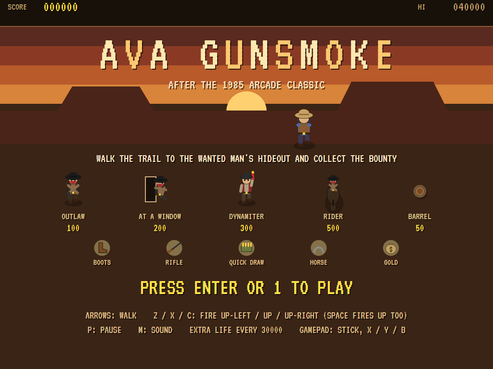
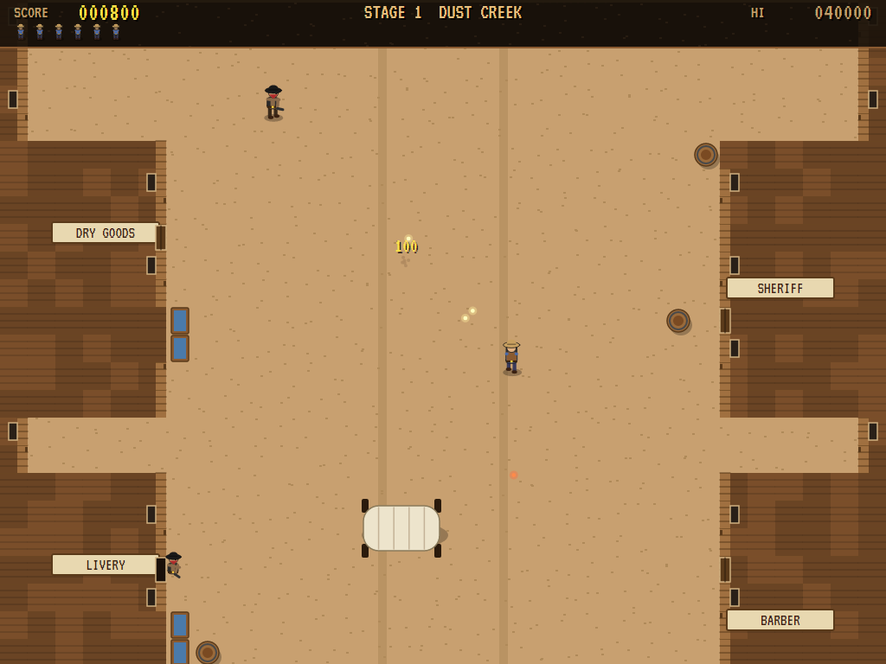
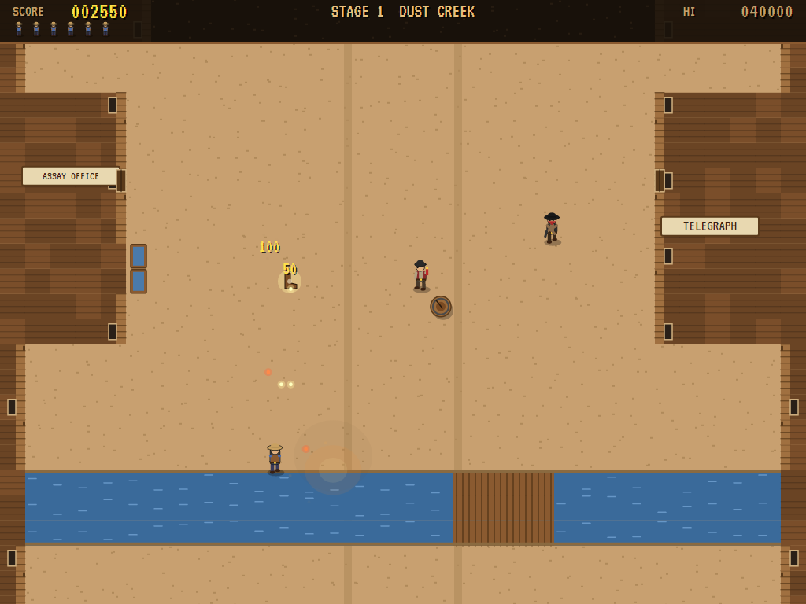
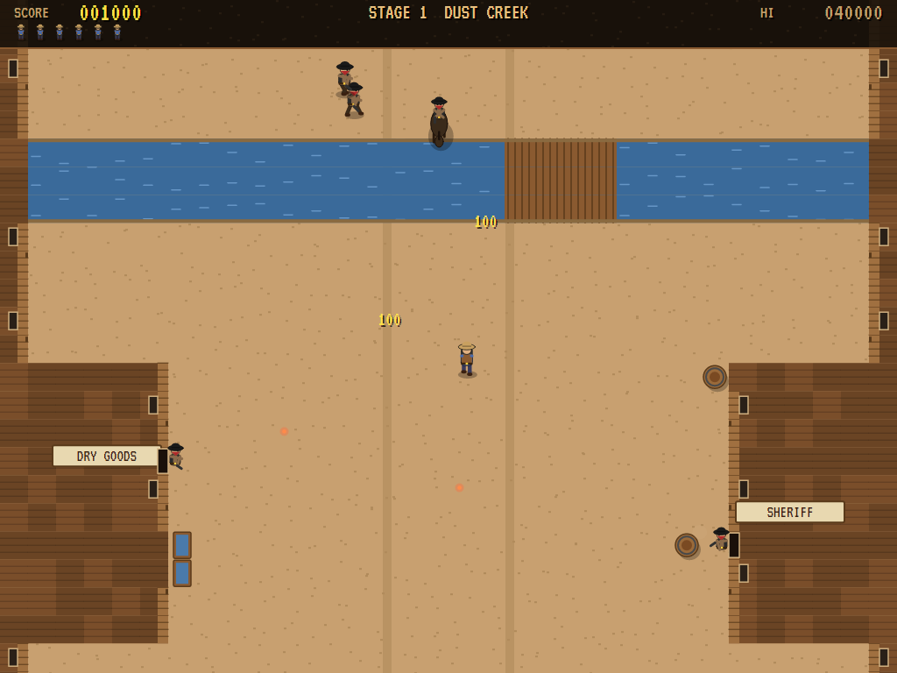
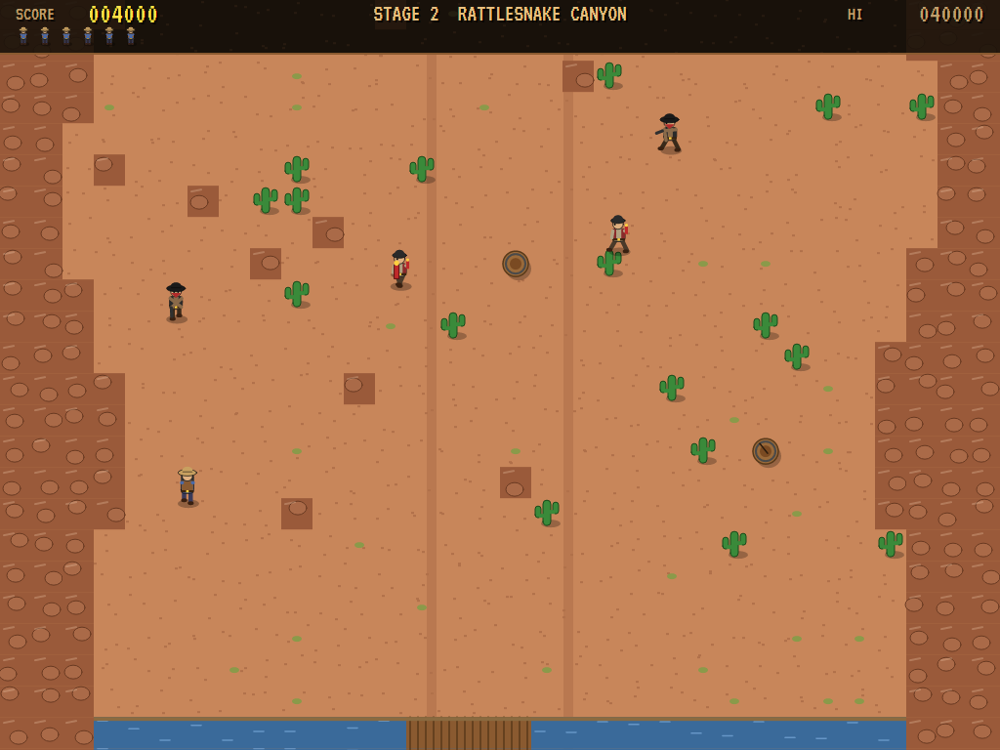
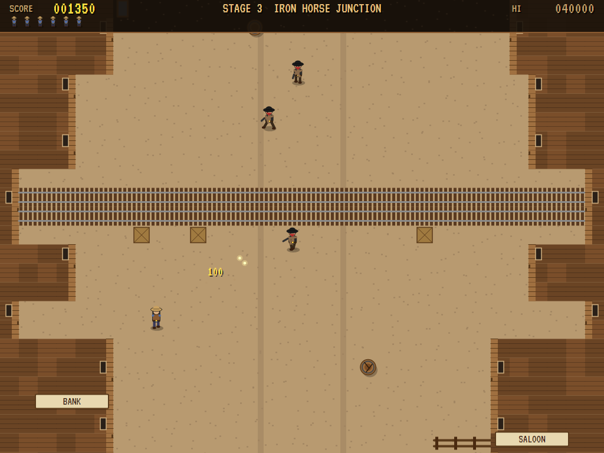
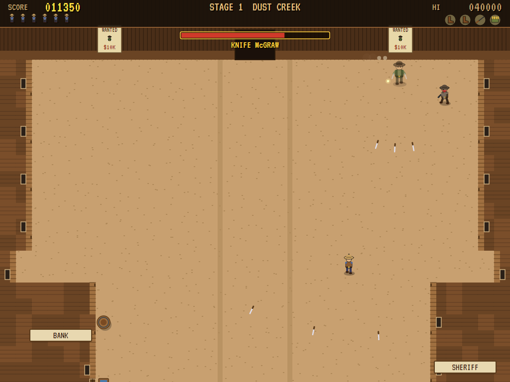
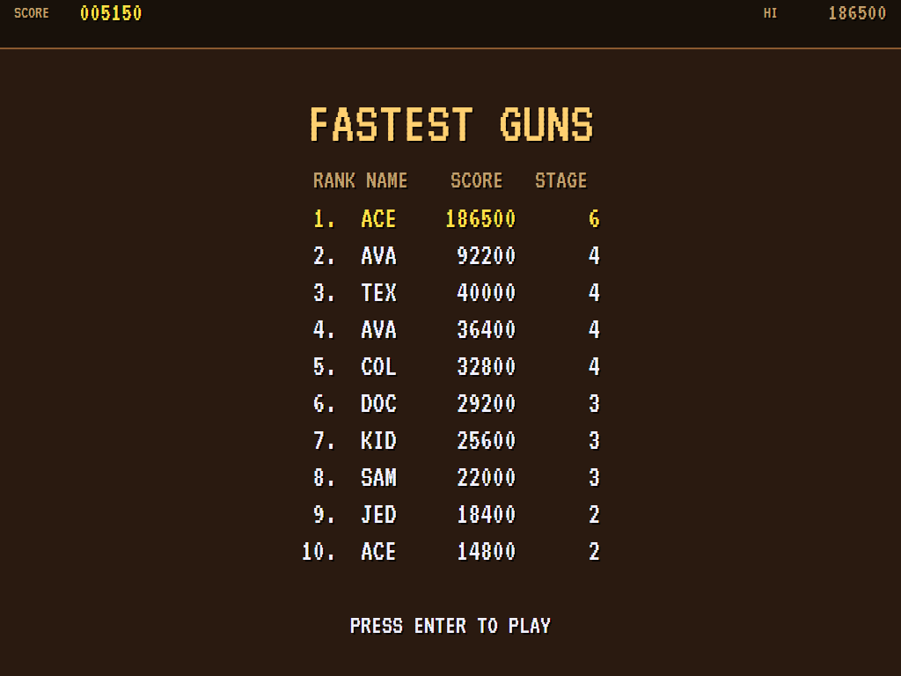

# AVA GunSmoke

[](https://github.com/Harlock123/AVAGunSmoke/actions/workflows/build.yml)

A Wild West shoot-'em-up in the style of Capcom's 1985 arcade game **Gun.Smoke**, built with .NET 10 and
Avalonia UI. A gunslinger walks up a frontier trail with a six-gun in each hand. Three triggers fire both guns
up and to the left, straight up, or up and to the right. The trail runs through a town of shopfronts, where
gunmen lean out of the windows, and on through a canyon and a railroad junction. Outlaws come at you on foot
and on horseback, and barrels in the road hide boots, a rifle, quick-draw bullets, a horse and gold. At the end
of each stage the wanted man comes out of his hideout to fight, and you collect the bounty on his head.

## Features

- **The gunslinger** walks eight ways. Each trigger fires a pair of bullets, one from each gun, the way it
  points: **up-left**, **up** or **up-right**. A pair hits a target only once.
- **What's in the barrels** (three shots break one open):
  - **Boots** make you quicker (two pairs, at most).
  - A **rifle** shoots further.
  - **Quick draw** fires faster, with more shots in the air.
  - A **horse** carries you quicker and takes three hits for you.
  - A **bag of gold** is worth 1000.
  - Lose a life and you're back to just your guns.
- **The outlaws:**
  - **Outlaws** (100) walk to a spot, stop, draw and fire.
  - **Gunmen at windows** (200) lean out of the shopfronts to fire and duck back in. You can only hit them
    while they're out.
  - **Dynamiters** (300) lob lit sticks over everything.
  - **Riders** (500) gallop down the street firing. They take two hits and trample anyone in the way.
- **The trail moves on without you.** The screen creeps up on its own, and faster if you walk ahead. It only
  waits if you hang back at the bottom, and the outlaws keep coming even then.
- **Three stages**, each ending in a showdown with a wanted man in front of his hideout:
  - **Dust Creek** (a town with a creek through it): **Knife McGraw**, wanted for cattle rustling ($10,000),
    throws knives in a fan.
  - **Rattlesnake Canyon** (rock walls and cacti): **Dynamite Dolan**, wanted for robbing the bank
    ($20,000), throws dynamite two sticks at a time.
  - **Iron Horse Junction** (a railroad town): **Colonel Crane**, wanted for holding up the mail train
    ($30,000), sweeps the street with a hand-cranked gun.
  - Each wanted man's gang comes out to help him. He stands still a moment each time he attacks: that's your
    chance to get under him.
  - The stages come round again with bigger bounties and tougher outlaws. There's an extra life every 30000.
- **The attract mode** plays itself through each stage in turn. The computer player:
  - gets below its targets, in line with one of the three ways the guns fire
  - backs away from outlaws it can't shoot
  - opens barrels and picks up what's inside
  - steps out of the way of bullets, dynamite and riders
- **The sounds** are all synthesised: six-gun cracks, ricochets, hoofbeats, a showdown chord, and a loping
  trail tune over the clip-clop of hooves.

## Screenshots

| The title | Dust Creek | A barrel's gift |
|:---------:|:----------:|:---------------:|
|  |  |  |
| The outlaws and what's in the barrels. | A gunman at a window. | Boots, a rifle or a horse. |

| A rider | Rattlesnake Canyon | Iron Horse Junction |
|:-------:|:------------------:|:-------------------:|
|  |  |  |
| Galloping down the street. | Dynamite by the creek. | Over the rails. |

| The showdown | The high scores | |
|:------------:|:---------------:|:-:|
|  |  | |
| Knife McGraw at his hideout. | The fastest guns. | |

The screenshots are made by the tests, which play the game in a real (headless) window; see
[Tests](#tests).

## Download and run

Ready-to-run builds for Windows, macOS and Linux, on both Intel/AMD and ARM, are on the
[Releases page](https://github.com/Harlock123/AVAGunSmoke/releases/tag/latest). **Latest build** is
rebuilt on every push to `main`. Each download is one self-contained executable: no .NET install is
needed.

| Platform | Archive |
|---|---|
| Windows | `AVAGunSmoke-win-x64.zip`, `AVAGunSmoke-win-x86.zip`, `AVAGunSmoke-win-arm64.zip` |
| macOS | `AVAGunSmoke-osx-arm64.tar.gz` (Apple silicon), `AVAGunSmoke-osx-x64.tar.gz` (Intel) |
| Linux | `AVAGunSmoke-linux-x64.tar.gz`, `AVAGunSmoke-linux-arm64.tar.gz`, `AVAGunSmoke-linux-arm.tar.gz` |

```bash
tar -xzf AVAGunSmoke-linux-x64.tar.gz     # or linux-arm64, linux-arm, osx-arm64, osx-x64
./AVAGunSmoke
```

On Windows, unzip and run `AVAGunSmoke.exe`. On macOS, if Gatekeeper refuses to open it, run
`xattr -d com.apple.quarantine AVAGunSmoke` once. Run with `--no-audio` for silence.

**Sound** comes through OpenAL Soft, built in for every platform. In a virtual machine the game
detects it and uses a larger audio buffer, so the sound doesn't break up.

**Gamepads** use SDL2, which is bundled for Windows, macOS and Intel/AMD Linux. ARM Linux builds need it
installed; without it the keyboard still works:

```bash
sudo apt install libsdl2-dev            # Debian / Ubuntu / Raspberry Pi OS
sudo pacman -S --needed sdl2-compat     # Arch / Omarchy
```

## Controls

| Action | Keyboard | Gamepad |
|---|---|---|
| Start | Enter or 1 | Start |
| Walk (eight ways) | Arrow keys (or W A S D) | Left stick / D-pad |
| Fire up-left | Z (or Q, J) | X or left bumper |
| Fire up | X, Space or Ctrl (or K) | Y or A |
| Fire up-right | C (or E, L) | B or right bumper |
| Pause | P or Esc | Start |
| Quit (while paused) | Esc | Back |
| Sound on/off | M | |
| Screenshot | Ctrl+S (to your Pictures folder) | |

On the high-score table, type your initials, or use up/down and Space, then Enter.

## Tests

```bash
dotnet test AVAGunSmoke.slnx
```

The engine has no UI and runs in fixed 60 Hz steps, so it plays the same at any frame rate, and a seed
always plays the same game. The tests check:

- **The trail:** every stage a way up to the wanted man's hideout, with its barrels, shopfronts and windows,
  the same each time; the three stages in turn, and the wanted men coming back worth more
- **The gunslinger:**
  - walking eight ways, quicker in boots and on a horse
  - shopfronts and water stopping him, and bridges not
  - each trigger firing both guns its own way
  - so many shots at once, more with quick draw, and further with the rifle
  - barrels taking three shots
  - picking up what's in them
- **The outlaws:**
  - one stopping, drawing and firing, and a bullet costing a life and everything carried
  - a horse taking three hits
  - a gunman at a window only hittable while he leans out
  - a rider taking two hits and trampling
  - dynamite's blast
- **The machine:**
  - the screen creeping up on its own, following him, and waiting while he hangs back
  - the outlaws in the map coming on as the screen reaches them
  - each wanted man's own way of fighting, and his bounty
  - extra lives, the last life, and initials
  - the title, demonstration and high scores, and starting a game
  - the computer player bringing in the first wanted man
  - the same game from the same seed, and pausing

The screenshot tests draw the real screen in a headless window. To refresh the README's pictures:

```bash
GUNSMOKE_SHOTS=$PWD/Images dotnet test tests/AVAGunSmoke.Tests --filter ScreenshotTests
```

To see how the computer player gets on, stage by stage (the walk to the hideout, and the showdown there; `1` for
the pilot, `lazy` for one that just walks up the street firing straight ahead):

```bash
GUNSMOKE_PROBE=1 dotnet test tests/AVAGunSmoke.Tests --filter PilotProbe --logger "console;verbosity=detailed"
```

## Building

```bash
dotnet build AVAGunSmoke.slnx
dotnet run --project src/AVAGunSmoke
```

Needs the .NET 10 SDK. The sounds are made by `tools/make_sounds.py` (standard-library Python):
`python3 tools/make_sounds.py` rewrites `src/AVAGunSmoke/Sounds`.

## Project structure

```
AVAGunSmoke/
├── AVAGunSmoke.slnx
├── src/AVAGunSmoke/
│   ├── Engine/
│   │   ├── GameEngine.cs        # States, the title and demo cycle, the trail tune
│   │   ├── GameEngine.Play.cs   # The gunslinger, his guns and what he picks up; the scrolling; the outlaws,
│   │   │                        # windows and riders; barrels; the wanted men; scoring
│   │   ├── SlingerPilot.cs      # The computer player, for the demonstration (and the tests)
│   │   ├── Entities.cs          # The stages and how their maps are built; the wanted men; everyone else
│   │   ├── HighScoreTable.cs, InitialsEntry.cs
│   │   ├── InputHandler.cs, ControllerManager.cs  # Keys and an SDL2 gamepad
│   │   └── SoundManager.cs      # Effects and the tunes through OpenAL
│   ├── Audio/                   # The OpenAL engine (from the author's AVABand)
│   ├── Views/                   # The drawing: the town, canyon and railroad, the people, horses and screens
│   └── Sounds/                  # The synthesised effects and tunes
├── tests/AVAGunSmoke.Tests/     # Gameplay, screenshot and probe tests
├── tools/make_sounds.py
└── Images/                      # Screenshots
```

## About and licence

AVA GunSmoke © 2026 Lonnie Watson, under the [MIT License](LICENSE).

*Gun.Smoke* © 1985 Capcom; the name belongs to its current owner. AVA GunSmoke is an independent, unofficial
game in its style. Its gunslinger, its towns, outlaws and wanted men, its graphics, sounds, tunes and code are
its own; nothing is taken from the arcade machine's program, graphics, sound or music. It is not affiliated
with or endorsed by any rights holder.
